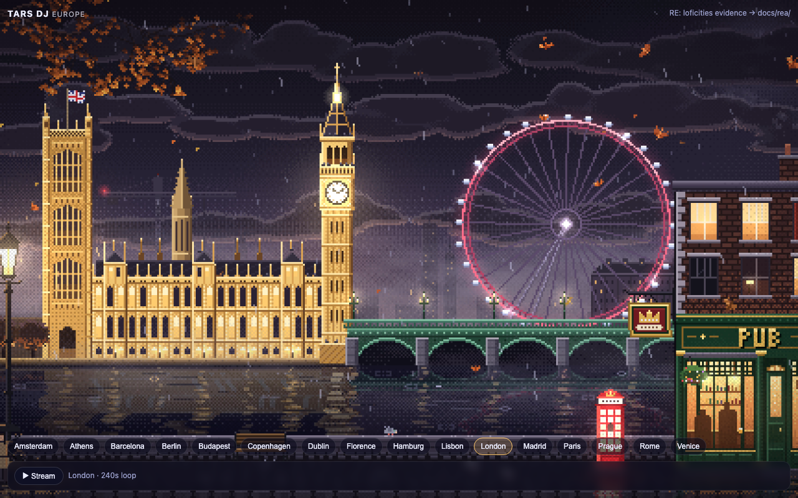
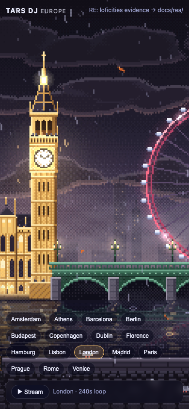
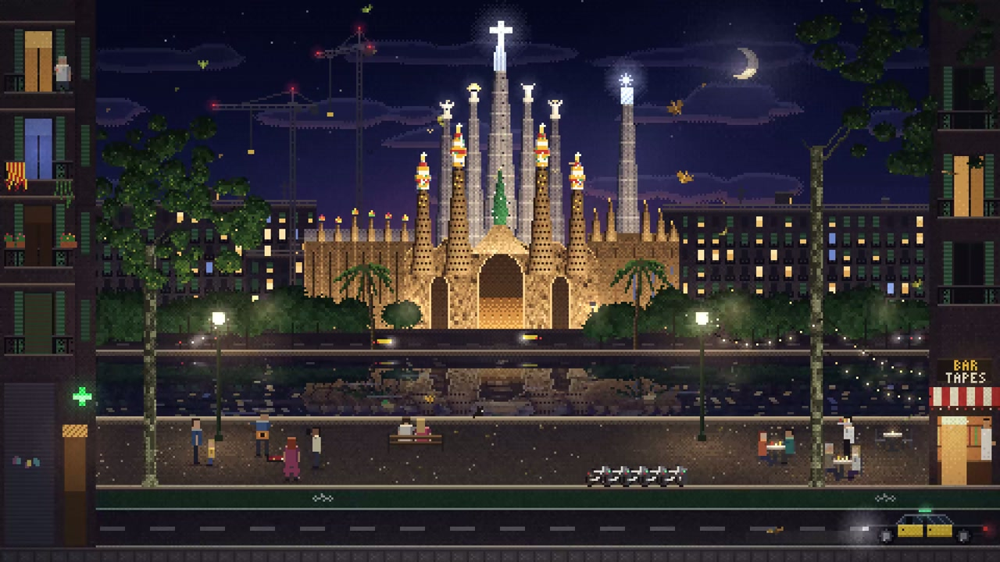
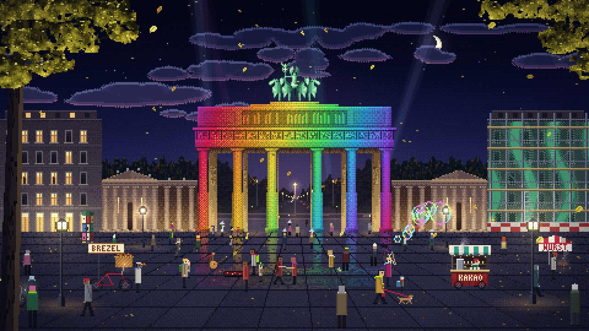
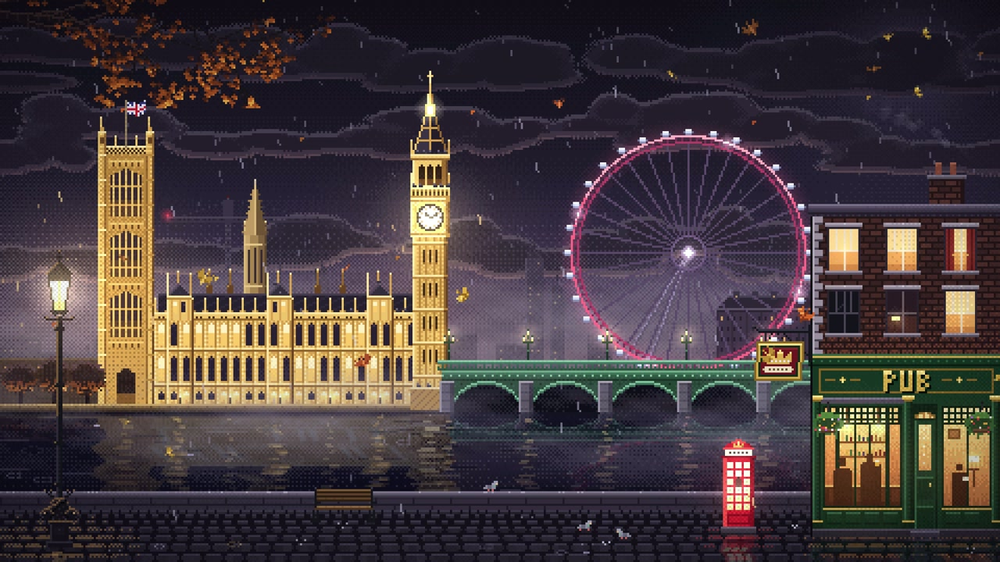
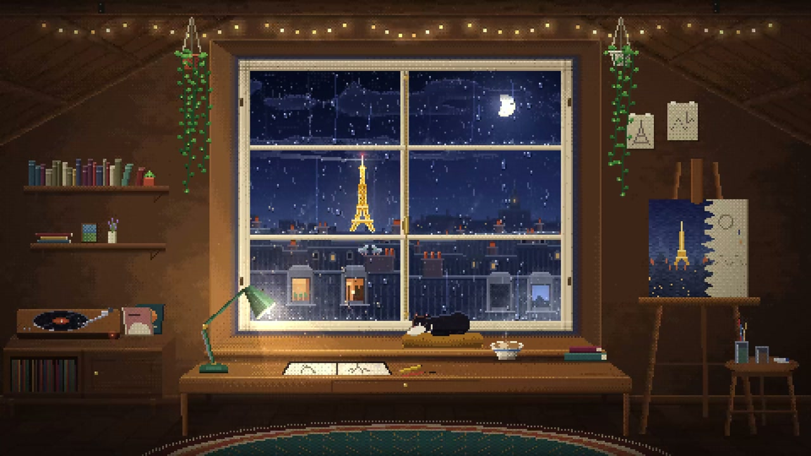
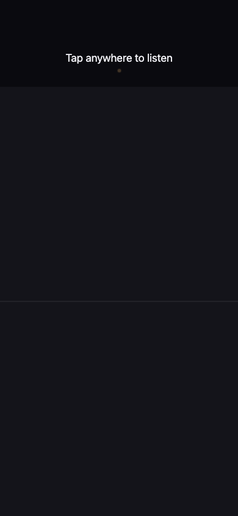
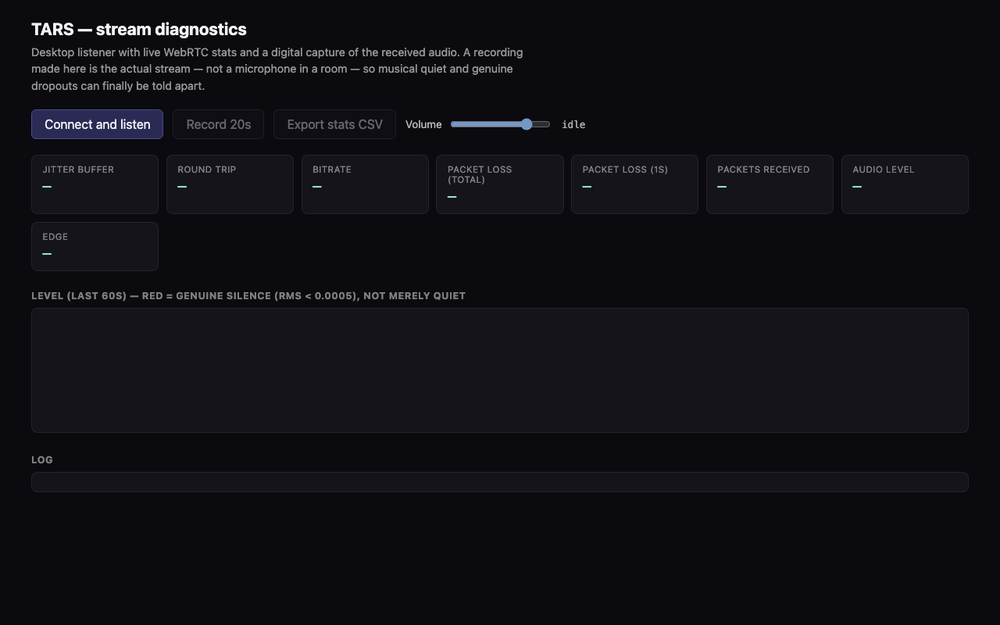
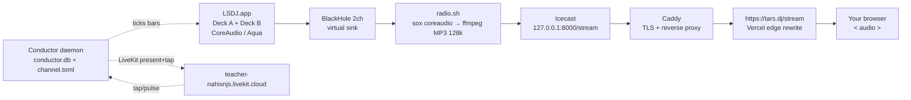

# TARS DJ — two DJs, one night. Europe after dark, live.

> **Not a playlist. A room with two decks that never stops mixing.**
>
> **[▶ Listen live — tars.dj](https://tars.dj)** · `tars.dj` is a 24/7 radio. Two autonomous DJ agents run real decks on a Mac mini, beatmatch into each other for hours, and stream the master to a canvas of 16 European cities at night. One listener hears one seamless set. Underneath, two taste engines negotiate every transition.

[](https://tars.dj)
[](#-europe-16-cities-one-seamless-stream) 
[](#-the-djs-themselves-forked-from-crowd-loop--lsdj) 
[](https://github.com/morluto/rea)

---

## Contents

- [Preview — tars.dj live](#preview--tarsdj-live)
- [Preview — the DJ engine: crowd-loop / LSDJ](#preview--the-dj-engine-crowd-loop--lsdj)
- [What this is](#what-tars-actually-is)
- [The two-deck conversation](#the-two-deck-conversation-why-two)
- [What each DJ can do](#what-each-dj-can-do)
- [How the DJs play off each other](#how-the-djs-play-off-each-other)
- [The DJs themselves — forked from crowd-loop / LSDJ](#-the-djs-themselves-forked-from-crowd-loop--lsdj)
- [How it sounds so good — Mac mini M4 → your ears](#how-it-sounds-so-good--mac-mini-m4--your-ears)
- [The frontend — tars.dj](#the-frontend--tarsdj)
- [Europe: 16 cities, one seamless stream](#-europe-16-cities-one-seamless-stream)
- [More crates are coming — the format is genre-agnostic](#more-crates-are-coming--the-format-is-genre-agnostic)
- [Stack](#stack)
- [Project layout — what's open source, what's not, and why](#project-layout--whats-open-source-whats-not-and-why)
- [Run it locally](#run-it-locally)
- [Deploy & operations](#deploy--operations)
- [Credits](#credits)

---

## Preview — tars.dj live

| tars.dj — desktop | tars.dj — phone |
|---|---|
|  |  |

City loops — 1080p60 seamless night scenes (owned packs, not generative filler):

| Amsterdam — canals at night | Barcelona — Mediterranean blue | Berlin — TV tower glow |
|:---:|:---:|:---:|
|  |  |  |
| London — river city | Rome — eternal city | Paris — city of light |
|  |  |  |

> 16 owned 1080p60 H.264 loops, 240 s seamless each, ~3.9 GB total — served from Cloudflare R2. Same spec as the reference site's 4-min night loops. No stock footage, no AI wallpaper slop.

---

## Preview — the DJ engine: crowd-loop / LSDJ

> TARS DJ's brains are **not** this site. The decks run 24/7 on a headless box under [`crowd-loop`](https://github.com/fraserbrownirl/crowd-loop) — an autonomous audience-steered DJ that drives real LSDJ decks through MCP. See [§ The DJs themselves](#-the-djs-themselves-forked-from-crowd-loop--lsdj). These screenshots are from the live PWA listener that the same Conductor runs.

| Listener PWA — tap surface (mobile) | WebRTC diagnostics (`/debug.html`) |
|---|---|
|  |  |
| **Audience path:** one screen — pulse glow + a two-zone tap surface (`more` / `next`). A tap is the only signal. The box listener UI is intentionally minimal; the music does the talking. | **Why Icecast, not WebRTC, for the audience:** measured 15–21% bursty last-mile loss that Opus concealment couldn't fix. Buffering beats realtime for radio. Kept as a diagnostic only. |

Private repo: [`fraserbrownirl/crowd-loop`](https://github.com/fraserbrownirl/crowd-loop) · runs on **FRS1** (Mac mini M4, host `greenmini`) · LSDJ + `mrt2_small` · LiveKit (`teacher-nahixnjs.livekit.cloud`) · `conductor.db` · `channel.toml`

---

## What TARS actually is

Most "AI radio" is a single queue — pick, play, crossfade, repeat.

TARS is different. Two **full DJ agents** run at the same time, each with its own crate, tempo clock, and taste, mixing into a shared master bus. One holds the floor while the other hunts, cues, warps, and proposes the next move. When they agree, the handoff happens — in phrase, on beat, in key.

```
Deck A  ████████████████▓▓▓▓░░░░  Deck B
        ← holding · filtering    cueing · nudging →

               ↓  bar 32 — both DJs agree: handoff  ↓

Deck A  ░░░░▓▓▓▓████████████████  Deck B
        ← digging next crate     holding · riding →
```

*Hold → hunt → negotiate → handoff.* That loop is the whole product.

- **One deck can only react.** Two decks can *anticipate*. That's the difference between a crossfade and a mix.
- **No skips, no gaps, no algorithm shuffle.** Audience steering (when enabled) is the room saying *more of this* or *move on* — the DJs interpret, not obey.
- **TARS DJ** (this repo, `tars.dj`) is the **public radio surface** — canvas + stream player + city collection. The **DJ engine** lives in `crowd-loop` on the mini (see below). The README documents both so a contributor understands where the music comes from.

---

## The two-deck conversation (why two)

A single-track recommender has no notion of *where a mix is going*. Two decks change the problem from "what's next?" to "how do we get there together?"

- **One holds, one hunts.** The on-air deck owns the master bus; the off-air deck is already three blends deep in the crate, pre-analysed and warped.
- **Proposals, not commands.** The hunting deck posts a handoff proposal — target bar, warp, key fit, blend shape. The holding deck can accept, ask for 8 more bars, or veto outright.
- **Long-horizon taste.** If the room has been deep + dubby for 20 minutes, both decks know to stay there — or to *earn* the lift, not just slam it.
- **Coherence over novelty.** The radio's job is coherence across minutes and hours (two decks, two sidecars, one arc), not novelty per track. This is what two-deck mixing buys that a queue cannot.

---

## What each DJ can do

> Each deck is a complete mixing agent, not a recommender. Capabilities here track the live `crowd-loop` Conductor — see `crowd-loop/conductor/` for source (currently private; open-source plan below).

| Capability | What it means |
|---|---|
| **MCP control** | Drives real LSDJ decks through `Streamable HTTP MCP` — `set_style`/`set_style_cursor`/`set_prompt`/`set_notes`/`set_drums`/mixer (`set_crossfade`/`set_volume`/`set_eq`/`set_trim`)/FX/`deck_play`/`deck_stop` — discovered + pinned against `contract/mcp-v1.json` (R1) |
| **Crate & memory** | Persistent crate from `conductor.db` + lifecycle (`candidate → active → core → cooling → retired`, fatigue vs rejection, 3-strikes-across-≥2-sessions, blend promotion, nightly stats). Lateral or vertical digs, not random picks |
| **Live analysis** | BPM/key/energy via `mrt2_small` sidecars (one per deck); every candidate reanalysed on load; key-compatibility + loudness/density awareness; honesty-gated `live_beat` when confidence is there |
| **Beat, phrase, tempo** | Bar-accurate phrase boundaries; tempo nudging/warp/sync via `sync_deck`/`set_tempo`/`beat_loop` — handoffs quantised to 8/16/32-bar phrase edges; `±6%` warp window to meet the outgoing then ride back |
| **Mix craft** | 3-band EQ + filter + gain per deck; transition vocabulary (long blend / quick cut / echo-out / tease-and-pull); effect tails get the bars they need |
| **Signal & steering** | 15 s wall-aligned windows, EWMA baseline (half-life 300 s, frozen in `MEASURE`), per-listener tap caps, `tap_z` + `churn_z` → composite `R`, dead-band; Thompson sampling + approval-slope modulation; keep/change two-zone `TransitionLoop` when `transitions.enabled` |
| **State machine** | Strict one-intervention-in-flight: `IDLE → ACT → LATENCY_WAIT → MEASURE → (COMMIT|ROLLBACK) → IDLE` + `NOOP_CALIBRATE` + `SAFE_HOLD`; replay-faithful wall-clock boundaries; `t_audible` measured per model |
| **Health (5 rungs)** | 5 s supervisor — `RMS probe silence` > `model truth` > `control/delivery` > `musical (BPM)` > `crowd N=0`; freeze policy + `deck_stop`/`deck_play`, `pkill lsdj` via `launchd`, delivery watchdog, calibration holds |
| **Live room** | LiveKit SFU (`teacher-nahixnjs.livekit.cloud`) — audience taps in, conductor pulse out; `pulse.ts` glow; `conductor-` identity prefix pinning (R16); narrow `canPublishData` grants via `pwa/api/token.ts` |
| **Arc & programme** | `programme/arc.ts` time-of-day energy curve + Thompson booking (`explore / familiar / song`) + `TrackQueue` + quantised `TransitionEngine` crossfades |

*Nothing here is speculative — it is the actual conductor on `greenmini`. Check `conductor/src/loop/machine.ts`, `conductor/src/signal/`, `conductor/src/programme/`, `conductor/src/health/`, `conductor/src/livekit/`, `pwa/src/`.*

---

## How the DJs play off each other

The listener hears one DJ who always knows what's next because there are literally two of them.

1. **Hold.** Deck A owns master. Deck B muted, digging. Conductor ticks bars + broadcasts phrase state; programme/arc sets the energy lane.
2. **Propose.** Deck B finds a candidate, reanalyses it, warps tempo, posts a proposal: *in-key, 4% pull, wants bar 33, 16-bar blend, highs first*.
3. **Counter.** Deck A checks its outro — vocal? breakdown? — and can accept, ask for +8 bars, or reject and send Deck B digging again. Approval-slope + explore floor gate the move.
4. **Align.** On accept: both decks lock clock, Deck B cues off-air, Deck A begins outro EQ. `LATENCY_WAIT` covers `t_audible`.
5. **Handoff.** At the agreed bar: filters cross, bass swaps on the one, Deck B takes master, Deck A mutes and becomes the digger. `MEASURE` windows decide commit vs rollback; nightly stats log the verdict.

> **Veto power is real.** Either deck can refuse if energy delta, vocal clash, or phrase would land awkwardly. A bad blend never ships — the Conductor rolls back and the room never hears the mistake.

---

## 🎛 The DJs themselves — forked from crowd-loop / LSDJ

TARS DJ's mixing brain is **not** in this repo. It's `crowd-loop` — a private TypeScript monorepo that runs the show from `~/Dev/crowd-loop` on `FRS1` (`greenmini`, Mac mini M4).

| Component | Role | Where it lives |
|---|---|---|
| **LSDJ.app** | Native macOS DJ host — two virtual decks, real `CoreAudio` graph, Aqua session | `/Applications/LSDJ.app` on the mini |
| **Conductor** | Headless daemon — track selection, bar/measure clock, bandit, programme, health, LiveKit sync; SQLite WAL at `conductor.db`; config in `channel.toml` | `crowd-loop/conductor/` (41 tests) |
| **`mrt2_small` sidecars** | One ML model per deck — BPM/key/energy/begin, fed from Conductor audio taps | `conductor/src/mcp/`, `deploy/` sidecar config |
| **PWA listener** | Audience path — one screen (ad strip + pulse + **tap surface**: top half `more`, bottom half `next`) + presence + wake lock | `crowd-loop/pwa/` → `https://crowd-loop-listener.vercel.app` |
| **Publisher** | Publishing to the world — `radio.sh` (sox → ffmpeg) + Icecast + Caddy | `crowd-loop/deploy/publisher/radio.sh`, `deploy/launchd/`, `deploy/stream/` |
| **Library** | Per-channel prompt YAML — `lofi-1` curated crate (Balearic / cafe-del-mar / chill-house) | `crowd-loop/library/channels/lofi/prompts.yaml` (1–5 energy scale, never leaves genre) |
| **Docs & plans** | Canonical plan: `docs/plans/2026-08-06-001-feat-crowd-loop-v1-plan.md` + runbooks incl. `audio-diagnosis-2026-08-09.md` | `crowd-loop/docs/` |

*Why private today:* `crowd-loop` holds the live tuning, prompt library, launchd inventory, and box IP that are load-bearing on a production box behind an allowlist. See [Project layout — what's open source, what's not, and why](#project-layout--whats-open-source-whats-not-and-why) for the carve-out.

*Frontend UX provenance:* `tars.dj`'s canvas contract itself was reverse-engineered from [`loficities.com`](https://loficities.com) via [`morluto/rea`](https://github.com/morluto/rea) — evidence in [`docs/rea/loficities-evidence.md`](docs/rea/loficities-evidence.md). No code copied, no assets reused; contract reimplemented in Vite against owned loops.

---

## How it sounds so good — Mac mini M4 → your ears

The DJs don't run in the browser. They live on a dedicated headless **Mac mini M4** — real CoreAudio, real clock, no virtualization jitter — captured bit-clean and broadcast as buffered radio (not WebRTC).



| Stage | What | Why it sounds good |
|---|---|---|
| **LSDJ + Conductor** | Two decks mix inside LSDJ.app; Conductor owns selection + bar clock + LiveKit presence | Real DJ software — proper gain staging, EQ, limiter; every decision persisted |
| **BlackHole 2ch** | macOS virtual audio device captures the Aqua session's master output | Bit-clean capture, no loopback mic, no system sounds |
| **`radio.sh` — sox → ffmpeg** | `sox -t coreaudio` (ring-buffered ~1.0×) piped to `ffmpeg libmp3lame 128k CBR` via `/dev/fd` + `exec` — no orphans on `kickstart -k` | 128k is the FM sweet spot: everywhere-compatible, low buffering, still warm on laptop speakers; sox avoids ffmpeg's avfoundation frame drops |
| **Icecast** | Local `127.0.0.1:8000/stream` mount — the canonical broadcast | Battle-tested radio infra; reconnects cleanly; no WebRTC negotiation |
| **Caddy** | TLS termination + flush-interval disabled — `https://<icecast-origin>/stream` | Single stable HTTPS origin, no mixed-content, no port |
| **Vercel rewrite** | `vercel.json` — `{ "source": "/stream", "destination": "https://<icecast-origin>/stream" }` | Browser only ever sees `https://tars.dj/stream` — origin lives server-side, no IP in shipped HTML/JS |

**Latency:** ~6–10 s glass-to-glass (encode + Icecast buffer + edge). Intentional — radio should feel live, not twitchy.

**Reliability:** `launchd` plists keep Conductor, sidecars, and `radio.sh` alive across reboots; 5-rung supervisor freezes/pkills/restarts; coreaudiod stalls require a reboot (see `audio-diagnosis-2026-08-09.md`). Icecast source reconnects; a crashed deck leaves the other holding master.

---

## The frontend — tars.dj

The site is intentionally simple: one full-bleed `<canvas id="screen">`, one city picker, one play button. Everything else is the music.

- **Canvas renderer** (`src/main.js`) — hidden `<video muted loop playsInline>` blitted to canvas every `requestAnimationFrame` with cover-fit + DPR scaling — smoother than raw `<video>`, immune to browser letterboxing quirks.
- **City state** — `location.hash` + `localStorage.tars:city` — deep-linkable (`tars.dj/#paris`), survives reload.
- **Audio** — one `<audio>` at `/stream` (edge-rewritten to Icecast). No WebAudio graph in the client — the mix already happened on the mini.
- **No CORS foot-gun** — `crossOrigin` deliberately *not* set on `<video>`/`<audio>`. R2 serves `video/mp4` without CORS headers; setting it would fail every loop. Canvas taint is harmless (we never read pixels).

### Video delivery — Cloudflare R2

Vercel can't host 3.9 GB of video. Loops live on **Cloudflare R2** (`tars-loops` bucket, `loops/{filename}` keys) behind the public `pub-….r2.dev` URL, cached at the edge:

```
src/cities/index.js  →  const LOOP_BASE = "https://pub-….r2.dev"
public/manifest.json →  16 absolute video/mp4 URLs + { stream: "https://tars.dj/stream" }
```

Adding a city later: drop the MP4 in `public/loops/`, upload to R2 (`r2 object put --remote` under 300 MiB, else `tools/r2-relay/` multipart), add one line to `CITIES` + one to `manifest.json`, rebuild, `vercel deploy --prod`.

Full evidence & handovers: [`docs/rea/loficities-evidence.md`](docs/rea/loficities-evidence.md) · [`docs/rea/HANDOVER.md`](docs/rea/HANDOVER.md)

---

## 🌃 Europe: 16 cities, one seamless stream

All loops owned — licensed Europe collection (16 cities), same 4-min night-loop spec as the reference site:

> `1920×1080 · H.264 High@L4.2 · yuv420p bt709 · 60 fps · 240.0 s (14 400 frames) · no audio`

| # | City | File | # | City | File |
|---|------|------|---|------|------|
| 1 | Amsterdam | `lofi-cities-amsterdam-loop-4min-1080p60.mp4` | 9 | Hamburg | `lofi-cities-hamburg-loop-4min-1080p60.mp4` |
| 2 | Athens | `lofi-cities-athens-loop-4min-1080p60.mp4` | 10 | Lisbon | `lofi-cities-lisbon-loop-4min-1080p60.mp4` |
| 3 | Barcelona | `lofi-cities-barcelona-loop-4min-1080p60.mp4` | 11 | London | `lofi-cities-london-loop-4min-1080p60.mp4` |
| 4 | Berlin | `lofi-cities-berlin-loop-4min-1080p60.mp4` | 12 | Madrid | `lofi-cities-madrid-loop-4min-1080p60.mp4` |
| 5 | Budapest | `lofi-cities-budapest-loop-4min-1080p60.mp4` | 13 | Paris | `lofi-cities-paris-loop-4min-1080p60.mp4` |
| 6 | Copenhagen | `lofi-cities-copenhagen-loop-4min-1080p60.mp4` | 14 | Prague | `lofi-cities-prague-loop-4min-1080p60.mp4` |
| 7 | Dublin | `lofi-cities-dublin-loop-4min-1080p60.mp4` | 15 | Rome | `lofi-cities-rome-loop-4min-1080p60.mp4` |
| 8 | Florence | `lofi-cities-florence-loop-4min-1080p60.mp4` | 16 | Venice | `lofi-cities-venice-loop-4min-1080p60.mp4` |

Source of truth: `src/cities/index.js` (`CITIES`) + `public/manifest.json` (`cityLoops`). Filenames canonical — never rename (packs swappable 1:1).

---

## More crates are coming — the format is genre-agnostic

Launch is Europe-at-night. That's the vibe, not the ceiling.

Two decks is **genre-agnostic** — a blend is a blend whether it's jazzhop or dub techno. The Conductor speaks energy/key/phrase, not genre tags. Expansion is a crate problem, not architecture.

| Crate | Why two decks make it better |
|---|---|
| **Deep / Dub House** | 32-bar blends, filter rides, 3 a.m. patience — Berlin after-hours on the canvas |
| **Ambient / Downtempo** | Echo-outs, long tails, barely-there handoffs — DJs get *quieter* together |
| **Jazz / Neo-Soul / Bossa** | Crate-digging as the show: Brazilian pressings, Japanese jazzhop, dusty loops — two collectors trading finds |
| **Liquid DnB / Dub** | Faster clock, tighter negotiation — quick cuts, double-drops |
| **Classical / Medieval / Oud & Sitar** | Reference site proved these work as pixel-night vibes; we want them as real DJ sets |

> **What never changes:** *two decks, mixed simultaneously, creating one evolving listener experience.* No single-queue fallback, no "AI playlist" mode. Every station — however many — is two DJs deciding together what the next bar should feel like.

Want to propose a crate? Open an issue with a 10-track seed + one-line vibe. If two DJs can argue about it, it belongs on TARS.

---

## Stack

| Layer | Tech | Notes |
|---|---|---|
| DJ engine | `LSDJ.app` + Conductor + `mrt2_small` (`crowd-loop/conductor/`) | Two real decks, real analysis — `fraserbrownirl/crowd-loop` on the mini |
| Sync | LiveKit Cloud (`teacher-nahixnjs…`) | Room state + DJ intent broadcast |
| Capture | BlackHole 2ch (sox CoreAudio driver) | Bit-clean, ring-buffered ~1.0× |
| Encode | `radio.sh` / `ffmpeg` → MP3 128k CBR | Icecast source; WHIP path retired for audience |
| Broadcast | Icecast + Caddy (TLS, `flush_interval -1`) | `127.0.0.1:8000/stream` → `https://tars.dj/stream` |
| Video store | Cloudflare R2 (`tars-loops`) | 16 × 1080p60 240 s loops, `loops/{file}` keys |
| Frontend | Vite 6.4, vanilla JS, `<canvas>` + `<video>` | No framework, no shop, no IP in client |
| Hosting | Vercel (`frsr/tars-dj` + `crowd-loop-listener`) | `/stream` rewrite; token at `pwa/api/token.ts` |
| UX provenance | `loficities.com` via [`morluto/rea`](https://github.com/morluto/rea) | Evidence in `docs/rea/` — no code copied |

---

## Project layout — what's open source, what's not, and why

> **This repo (`TarsDJ` / `tars.dj`) is fully open-sourceable.** It contains only the public radio surface, the reverse-engineered UX spec, and infra wiring — no secrets.

```
TarsDJ/                            ← this repo — SAFE TO OPEN SOURCE (MIT)
├── index.html                     # #screen canvas + HUD + city picker + <audio>
├── src/
│   ├── main.js                    # rAF canvas blit, city state, stream play/pause
│   ├── style.css                  # --bg #05060f, glass pills
│   └── cities/index.js            # CITIES[16] + LOOP_BASE (R2) + loopUrl()
├── public/
│   ├── manifest.json              # 16 absolute R2 URLs + { stream: "https://tars.dj/stream" }
│   └── loops/                     # MP4s (gitignored — licensed art, not code)
├── docs/
│   ├── rea/
│   │   ├── loficities-evidence.md # REA spec (morluto/rea)
│   │   ├── HANDOVER.md            # Build log + R2 relay notes
│   │   └── CURSOR-R2-INSTRUCTION.md
│   └── images/                    # Screenshots — OWNED ART RENDERS — LICENSED
├── tools/r2-relay/                # Multipart R2 relay worker (>300 MiB uploads)
├── vercel.json                    # /stream rewrite → Icecast origin
├── vite.config.js
├── .env.TEMPLATE                  # Secret *shape* only — no values committed
├── DRAFT-README.md                # ← this draft (promote to README.md on approval)
└── README.md                      # Current live README (replaced once draft approved)

crowd-loop/                        ← separate repo — NOT in this open-source cut
├── conductor/                      # Policy daemon (TypeScript, Node ≥22, SQLite, MCP)
├── pwa/                           # Listener + /debug.html + pwa/api/token.ts
├── deploy/                        # radio.sh, icecast.xml, Caddyfile, launchd plists
├── library/                       # Prompt YAML (curated crate — proprietary)
├── channel.example.toml           # Safe — committed. channel.toml lives only on the mini
├── docs/                          # Plans + runbooks (publishable)
├── .gitignore → channel.toml, publisher.env, stream.env, dist, logs
└── BOX ONLY (never in any repo):  channel.toml, stream.env, publisher.env,
                                  LIVEKIT_API_SECRET, ICECAST_SOURCE_PASSWORD,
                                  box IP / SSH key / LiveKit keys
```

### Open-source triage — what ships, what stays back

| Ships (MIT, this repo) | Stays back (private or gitignored) | Why |
|---|:---|:---|
| All frontend code (`index.html`, `src/`, `public/manifest.json`, `vite.config.js`, `vercel.json`) | `public/loops/*.mp4`, `docs/images/*jpg` | Loops are licensed art — not code; redisplay is permitted, resale as packs is not |
| REA spec + handovers (`docs/rea/`) | `conductor.db` (`-shm`/`-wal`), `channel.toml`, `deploy/publisher/*.env` | Live tuning + audience data + secrets — would compromise the production box |
| Sanitized infra shape (`.env.TEMPLATE` keys only, `vercel.json` destination as documented) | Box IP, `LIVEKIT_API_SECRET`, `ICECAST_*_PASSWORD`, SSH keys | Secrets — rotate/revoke if ever leaked, never commit |
| Screenshots of tars.dj + conductor PWA (this README) | Raw Mac desktop captures with window chrome | Minimise box fingerprinting |
| `tools/r2-relay/` worker | — | Generic R2 helper, no secrets |

### Promotion checklist — before `git init` / public push

1. **Secrets sweep** — `rg -n '45\.148|sslip|api_secret|LIVEKIT_API_SECRET|ou6Yx|ICECAST.*PASSWORD'` — expect hits only in `docs/rea/HANDOVER.md` + `.env.TEMPLATE` placeholders + (now-sanitized) `vercel.json` destination. Scrub or `.gitignore` any real value that slipped in.
2. **Art licensing call** — MP4s + JPG renders stay in `.gitignore`; README images are fair-use renders with `Visuals: Lofi Cities — https://loficities.com` credit per the license. Confirm Gumroad terms unchanged before launch.
3. **`crowd-loop` decision** — keep `fraserbrownirl/crowd-loop` private. If later open-sourcing any of `conductor/`/`pwa/`, cut a sanitized mirror with: example configs only, no `channel.toml`/`dist`/secrets, redacted `channel.example.toml`, docs/plans included. PWA `config.ts` reads `/api` + meta tags — safe to publish without the env.
4. **Set `.gitignore`** — already covers `public/loops/`, `*.mp4`, `dist/`, `node_modules/`, `.vercel/`, `.env*` — keep it.
5. **Promote draft** — `cp DRAFT-README.md README.md` once screenshots render on GitHub preview (this file is the reviewable draft; `README.md` stays live until you sign off).

---

## Run it locally

```bash
npm i
npm run dev      # http://127.0.0.1:5173 — canvas + city picker + live /stream
npm run build    # dist/ — verify no IP/shop refs: rg -n '45\.|sslip|shop' dist/
```

Owned packs (gitignored — licensed art) → unzip to preview:

```bash
for f in ~/Downloads/lofi-cities-europe-part-*.zip; do
  unzip -o -j "$f" -d public/loops/
done
```

State: `#hash` + `localStorage tars:city` (default Paris). Vite dies when the Cursor terminal closes — keep it on `0.0.0.0:5173 --strictPort` or `npx serve dist -l 5173`.

---

## Deploy & operations

**Vercel — `frsr/tars-dj` (linked via `.vercel/project.json`):**

```bash
vercel deploy --prod --yes   # → www.tars.dj / tars.dj
```

`.vercelignore` excludes `public/loops`, `dist`, `loops`, `node_modules`, `.env*` — loops go via R2, not the upload.

**R2 — bucket `tars-loops`, keys `loops/{original filename}`, `content-type: video/mp4`:**

```bash
# <300 MiB — direct (requires CLOUDFLARE_API_TOKEN from ~/.config/cloudflare)
CLOUDFLARE_API_TOKEN=… wrangler r2 object put tars-loops/loops/<file> \
  --file=public/loops/<file> --content-type=video/mp4 --remote

# >300 MiB — redeploy tools/r2-relay/ per docs/rea/HANDOVER.md §10–11
```

**Stream** — only client-facing URL is `https://tars.dj/stream` (Vercel rewrite → Icecast origin). Origin lives server-side in `vercel.json` + `.env.TEMPLATE` shape — no IP in shipped HTML/JS/manifest.

**Box — `greenmini` (FRS1):** `ssh greenmini` → `~/Dev/crowd-loop`; `launchctl kickstart -k` for conductor/radio/icecast/caddy. See `crowd-loop/docs/runbooks/audio-diagnosis-2026-08-09.md` if capture drifts (reboot > `killall coreaudiod`).

---

## Credits

- **DJ engine:** [`fraserbrownirl/crowd-loop`](https://github.com/fraserbrownirl/crowd-loop) · `LSDJ.app` · `mrt2_small` sidecars · `Conductor` daemon · LiveKit Cloud. Real decks, real analysis; the 24/7 radio re-housing is TARS.
- **Site contract:** reverse-engineered from [`loficities.com`](https://loficities.com) via [`morluto/rea`](https://github.com/morluto/rea) — evidence in [`docs/rea/loficities-evidence.md`](docs/rea/loficities-evidence.md). No code copied, no assets reused.
- **City loops:** owned licensed Europe collection (16 × 1080p60 240 s seamless night loops).
- **Infra:** Mac mini M4 (`FRS1`) · BlackHole 2ch (sox) · Icecast · Caddy · Cloudflare R2 · Vercel · LiveKit Cloud.

---

<p align="center">
  <a href="https://tars.dj"><strong>▶ Listen live — tars.dj</strong></a> ·
  <a href="https://github.com/fraserbrownirl/crowd-loop"><strong>DJ engine — crowd-loop</strong></a><br/>
  <sub>16 cities · 2 decks · 1 stream that never stops mixing. DRAFT — awaiting screenshots + approval before public push.</sub>
</p>
