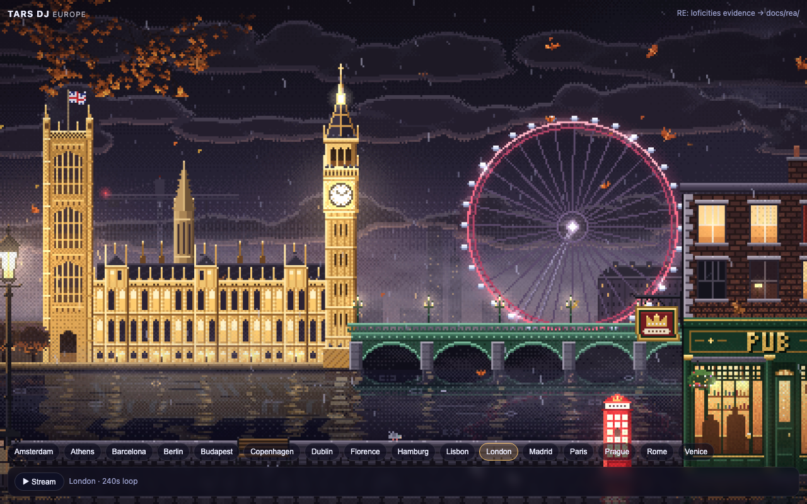
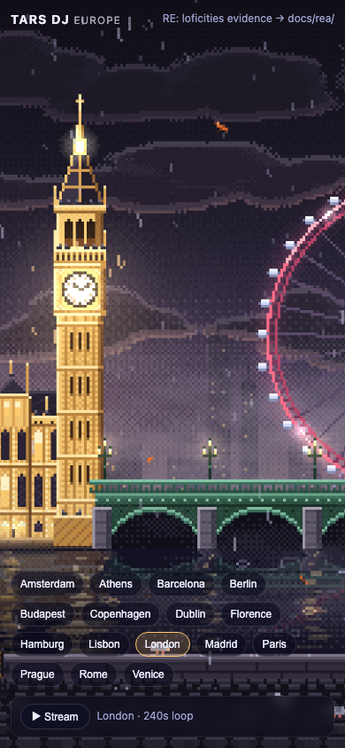

# TARS — Twin Agent Radio Station

> **Not a playlist. A station that hears itself, advises itself, and composes itself — entirely on-device, on [QVAC](https://qvac.tether.io/).**

**[▶ Listen live — tars.dj](https://tars.dj)**

Two autonomous DJs mix into each other 24/7. The station's intelligence is **Tether's QVAC local-AI platform**: every night a QVAC LLM reviews the station's own logs and writes its taste notes — no cloud, no API keys. Sixteen European cities after dark on the canvas.

[](https://tars.dj)
[](https://qvac.tether.io/)
[](https://github.com/fraserbrownirl/crowd-loop)

---

## Built on QVAC

TARS is an always-on showcase of [QVAC](https://qvac.tether.io/) — Tether's platform for running AI entirely on the user's hardware. Everything the station thinks, it thinks on the box that plays the music.

**Live every night — the taste advisor** ([`@qvac/sdk`](https://docs.qvac.tether.io/sdk/))
A Qwen3-4B LLM loads on the Mac mini, reads tap history, prompt health, and the energy arc from the station's own database, and writes its notes for the crate and the arc. Then it unloads and the box goes back to mixing. Zero inference leaves the machine.

**On deck — QVAC music generation** ([`@qvac/audiogen-ggml`](https://docs.qvac.tether.io/sdk/ai-capabilities/music-generation/))
ACE-Step 1.5 on QVAC, with per-song controls — BPM, key, time signature — and `audioUnderstand()` so the station can describe what it just played. The advisor's taste notes steer what the engine composes. The loop closes on-device: **a station that listens to its crowd, forms its own taste, and writes its own music.**

```
QVAC LLM (nightly)          →  taste: reads the logs, writes the notes
QVAC ACE-Step (on deck)     →  composition steered by those notes
Conductor + LSDJ / MRT2     →  the live mix today
BlackHole → Icecast         →  tars.dj/stream
```

---

## How it works

| Layer | What it does |
|---|---|
| **QVAC — the intelligence** | On-device AI end to end. Nightly LLM taste advisor (live); ACE-Step music generation with per-song musical controls and audio understanding (on deck). |
| **Conductor + LSDJ — the decks** | Audience-steered mixing on a Mac mini. Listeners tap *more* or *next*; two Magenta RealTime decks negotiate every handoff in phrase, on beat, in key. |
| **tars.dj — the room** | This repo. A canvas of 16 owned city-night loops and one Icecast stream. |

---

## Listen

| Desktop | Phone |
|---|---|
|  |  |

Pick a city. Hit play. The mix is already running.

---

## Cities

16 owned 1080p60 night loops, 240 s each, served from Cloudflare R2:

Amsterdam · Athens · Barcelona · Berlin · Budapest · Copenhagen · Dublin · Florence · Hamburg · Lisbon · London · Madrid · Paris · Prague · Rome · Venice

Source of truth: `src/cities/index.js`.

---

## Stack

| | |
|---|---|
| Intelligence | [QVAC](https://qvac.tether.io/) by Tether — Qwen3-4B via `@qvac/sdk` (live), ACE-Step 1.5 via `@qvac/audiogen-ggml` (on deck), fully on-device |
| Decks | [LSDJ](https://github.com/protocol-works/lsdj) + Magenta RealTime 2 |
| Policy | Conductor daemon — [`fraserbrownirl/crowd-loop`](https://github.com/fraserbrownirl/crowd-loop) (private) |
| Broadcast | BlackHole → sox/ffmpeg → Icecast → Caddy → Vercel `/stream` rewrite |
| Video | Cloudflare R2 |
| Site | Vite, vanilla JS, `<canvas>` |

The engine and the iOS listener live in the private monorepo. This repo is the public radio surface only.

---

## Run locally

```bash
npm i
npm run dev      # http://127.0.0.1:5173
npm run build
```

Stream URL comes from `public/manifest.json`. City state: `#hash` + `localStorage.tars:city`.

## Deploy

```bash
vercel deploy --prod --yes   # frsr/tars-dj → tars.dj
```

Loops go to R2 (`tars-loops` bucket), not the Vercel upload. See `docs/rea/HANDOVER.md`.

---

## Credits

- **Intelligence:** [QVAC](https://qvac.tether.io/) — Tether's local-AI platform · [music generation](https://docs.qvac.tether.io/sdk/ai-capabilities/music-generation/) via `@qvac/audiogen-ggml`
- **Decks:** [LSDJ](https://github.com/protocol-works/lsdj) · Magenta RealTime 2 · Conductor in [`crowd-loop`](https://github.com/fraserbrownirl/crowd-loop)
- **Site contract:** reverse-engineered from [loficities.com](https://loficities.com) via [morluto/rea](https://github.com/morluto/rea) — evidence in `docs/rea/`
- **Visuals:** owned Europe night-loop collection
- **Infra:** Green Mini Host · Icecast · Caddy · Cloudflare R2 · Vercel · LiveKit Cloud

<p align="center">
  <a href="https://tars.dj"><strong>▶ Listen live — tars.dj</strong></a>
</p>
